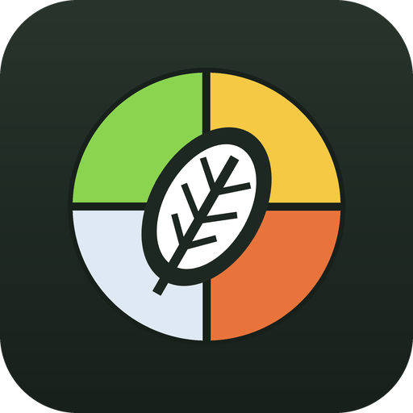
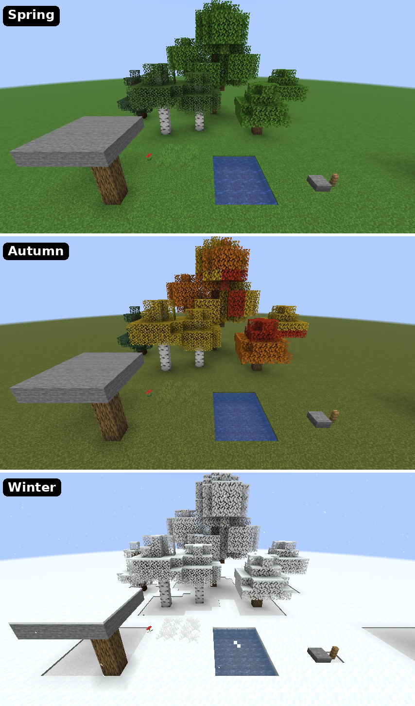
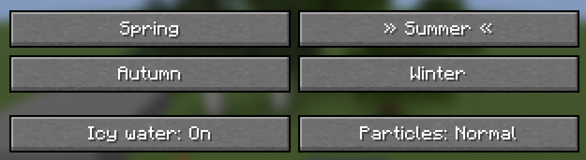
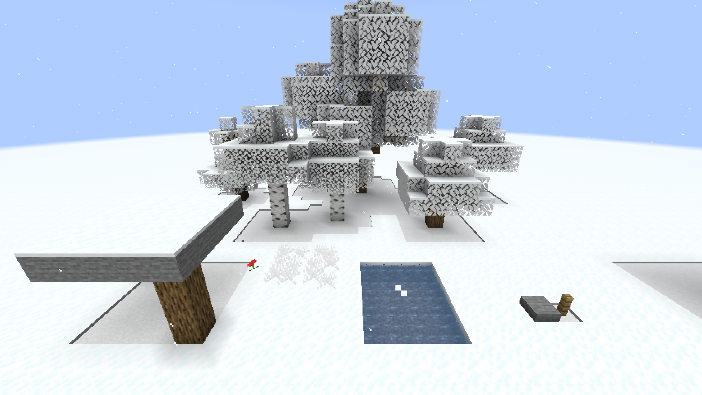

<p align="center">
  
</p>

<h1 align="center">Seasons Visual</h1>

<p align="center">
  Seasons that only you can see.<br>
  Colorful autumn leaves, snow in winter and blossoms in spring, even on servers you don't own.
</p>

<p align="center">
  <a href="https://github.com/Lenno70270/seasons-visual/releases/latest"></a>
  
  
  
  
  
</p>

---



<sub>The same spot in spring, autumn and winter. In-game screenshots.</sub>

Pick the season in the menu, and only you see it. The world and the server stay exactly the same, so the mod also
works on servers you don't own.

## How to use

Press **J** and choose a season. Your choice is saved in `config/seasons_visual.json` and stays after a restart. You
can change the key under Options, Controls, Key Binds.



| Season | What changes |
| --- | --- |
| 🌸 **Spring** | Brighter, fresh green, a few pink and white blossoms under trees |
| ☀️ **Summer** | Nothing, normal Minecraft look |
| 🍂 **Autumn** | Orange, red and yellow leaves depending on position, slightly brown grass, falling leaves |
| ❄️ **Winter** | White leaves and grass, a snow layer under open sky, snowfall, icy water |

The menu also has **Icy water** and **Particles** (Normal, Few, Off). For PvP, `Few` or `Off` is enough.



<sub>Winter: snow layer, snowfall and icy water. Not a single snow block is placed in the world.</sub>

The mod is available in English and German, depending on your game language.

## Installation

1. Install [Fabric Loader](https://fabricmc.net/use/) for Minecraft 26.2 (Java 25)
2. Put [Fabric API](https://modrinth.com/mod/fabric-api) into your `mods` folder
3. Add `seasons-visual-….jar` from the [releases](https://github.com/Lenno70270/seasons-visual/releases/latest)

[Sodium](https://modrinth.com/mod/sodium) is optional and supported.

## How it works

- **Colors:** Mixins on `BiomeColors`, which vanilla and Sodium both use. Spruce and birch have fixed colors, so they
  get their own tint.
- **Textures:** A tint can only darken. That's why leaves and grass are also brightened directly in the block atlas.
- **Snow:** Added to the mesh as a model while chunks are built, separately for vanilla and Sodium. It costs almost
  nothing per frame, and no block is placed in the world.
- **Particles:** A small, fixed amount per tick around the camera, without collision checks for snow. Minecraft's
  particle setting is respected.

## Known limits

- Leaves in your inventory also turn lighter or white, because they use the same texture.
- Spruce stays green in autumn on purpose. Cherry and azalea keep their colors in spring and autumn.
- After switching, it takes a moment until chunks are rebuilt, like F3+A.
- Not tested with shader packs yet. Iris itself works, but the look depends on the pack.

## Building and testing

Sodium is only needed to compile and isn't in the repository. Download `sodium-fabric-0.9.2+mc26.2.jar` from
[Modrinth](https://modrinth.com/mod/sodium) and put it into `libs/`. It is not bundled into the finished mod.

```bash
./gradlew build
```

The finished file is in `build/libs/`.

```bash
./gradlew runClientGameTest
```

The test opens a window and saves screenshots to `build/run/clientGameTest/screenshots`. With Sodium and Iris:

```bash
./gradlew runClientGameTest "-PextraMods=<path to mods folder>"
```

## License

MIT, see [LICENSE](LICENSE).
