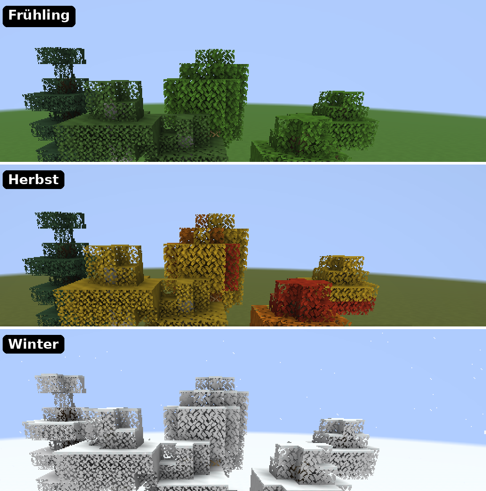
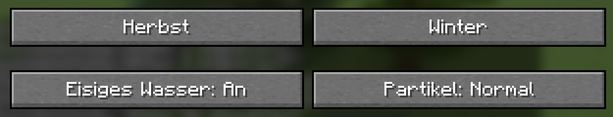

<p align="center">
  
</p>

<h1 align="center">Seasons Visual</h1>

<p align="center">
  Jahreszeiten, die nur du siehst.<br>
  Buntes Herbstlaub, Schnee im Winter und Blüten im Frühling, auch auf fremden Servern.
</p>

<p align="center">
  <a href="https://github.com/Lenno70270/seasons-visual/releases/latest"></a>
  
  
  
  
  
</p>

> **English:** Purely visual seasons that only you can see. Press **J** and pick spring, summer, autumn or winter.
> The world and the server stay unchanged, so it works on any server. Compatible with Sodium.

---



<sub>Dieselbe Stelle im Frühling, Herbst und Winter. Screenshots aus dem Spiel.</sub>

Du wählst die Jahreszeit im Menü, und nur du siehst sie. Die Welt und der Server bleiben unverändert, deshalb läuft
die Mod auch auf fremden Servern.

## So geht es

Drück **J** und wähl eine Jahreszeit. Die Auswahl steht in `config/seasons_visual.json` und bleibt nach dem Neustart
erhalten. Die Taste lässt sich unter Optionen, Steuerung, Tastenbelegung ändern.



| Jahreszeit | Was sich ändert |
| --- | --- |
| 🌸 **Frühling** | Heller, frischer Grünton, vereinzelt rosa und weiße Blüten unter Bäumen |
| ☀️ **Sommer** | Nichts, normale Minecraft-Optik |
| 🍂 **Herbst** | Laub in Orange, Rot und Gelb je nach Position, leicht bräunliches Gras, fallende Blätter |
| ❄️ **Winter** | Weißes Laub und Gras, Schneeschicht unter freiem Himmel, Schneefall, eisiges Wasser |

Im Menü gibt es außerdem **Eisiges Wasser** und **Partikel** (Normal, Wenig, Aus). Für PvP reicht `Wenig` oder `Aus`.


<sub>Winter: Schneeschicht, Schneefall und eisiges Wasser. In der Welt steht dabei kein einziger Schneeblock.</sub>

## Installation

1. [Fabric Loader](https://fabricmc.net/use/) für Minecraft 26.2 installieren (Java 25)
2. [Fabric API](https://modrinth.com/mod/fabric-api) in den `mods`-Ordner legen
3. `seasons-visual-….jar` aus den [Releases](https://github.com/Lenno70270/seasons-visual/releases/latest) dazulegen

[Sodium](https://modrinth.com/mod/sodium) ist optional und wird unterstützt.

## Wie es funktioniert

- **Farben:** Mixins auf `BiomeColors`, die Vanilla und Sodium beide nutzen. Fichte und Birke haben feste Farben und
  bekommen deshalb eine eigene Tönung.
- **Texturen:** Eine Tönung kann nur abdunkeln. Laub und Gras werden deshalb zusätzlich direkt im Block-Atlas aufgehellt.
- **Schnee:** Wird beim Chunk-Bau als Modell ins Mesh geschrieben, für Vanilla und Sodium getrennt. Pro Frame kostet das
  fast nichts, und in der Welt steht kein Block.
- **Partikel:** Pro Tick eine feste, kleine Menge rund um die Kamera, ohne Kollisionsprüfung beim Schnee. Die
  Partikel-Einstellung von Minecraft wird beachtet.

## Bekannte Grenzen

- Auch Laub im Inventar wird heller oder weiß, weil es dieselbe Textur nutzt.
- Fichten bleiben im Herbst bewusst grün. Kirsche und Azalee behalten im Frühling und Herbst ihre Farben.
- Bis zum ersten Chunk-Neubau nach dem Wechsel dauert es kurz, wie bei F3+A.
- Mit aktivem Shaderpack ist die Mod noch ungetestet. Iris selbst läuft, das Aussehen hängt aber vom Pack ab.

## Bauen und testen

Sodium wird nur zum Kompilieren gebraucht und liegt nicht im Repository. Lade `sodium-fabric-0.9.2+mc26.2.jar` von
[Modrinth](https://modrinth.com/mod/sodium) und leg sie nach `libs/`. In der fertigen Mod steckt sie nicht.

```bash
./gradlew build
```

Die fertige Datei liegt danach in `build/libs/`.

```bash
./gradlew runClientGameTest
```

Der Test öffnet ein Fenster und legt Screenshots in `build/run/clientGameTest/screenshots` ab. Mit Sodium und Iris:

```bash
./gradlew runClientGameTest "-PextraMods=<Pfad zum mods-Ordner>"
```

## Lizenz

MIT, siehe [LICENSE](LICENSE).
